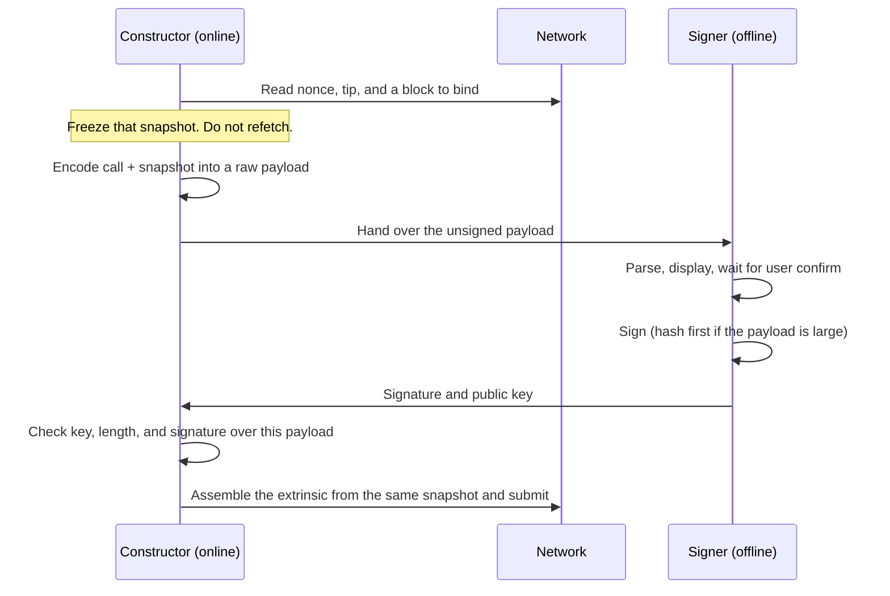

# Cold Wallet Signing

A **cold wallet** is a signer whose private key never touches a machine that can reach the network. The online side builds a transaction, the offline side reviews and signs it, and the online side broadcasts the result. This page describes that split in general terms. The Quantus CLI and cold-wallet apps implement it over animated QR codes; the same sequence works with files or any other sneakernet.

The key never leaves the device. Only a signing payload goes in, and only a signature plus public key come out.

## Roles

| Role | What it holds | What it is allowed to do |
|------|---------------|--------------------------|
| **Constructor** (online) | RPC, chain metadata, no spend key | Fetch nonce and block context, encode the call, display or write the unsigned payload, assemble and submit after signing |
| **Signer** (offline) | The spend key | Parse and show the payload, confirm with the user, produce a signature |
| **Transport** | Neither keys nor RPC | Move bytes between the two sides (QR, camera, USB file, stdin) |

If the constructor can also sign, it is a hot wallet. Cold signing exists so those two capabilities stay on different machines.

## Sequence

The important invariant: **nonce, tip, mortality, and block hash are captured once.** The payload the device sees and the extrinsic that is submitted are both built from that snapshot. Refetching a newer block or nonce after the user has looked at the QR silently invalidates the signature, or worse, produces a valid signature over a different intent.

## What is frozen in the payload

The unsigned payload is the **raw, unhashed** bytes the device can parse. Typical fields:

| Field | Why it is frozen |
|-------|------------------|
| Call | The actual action (recipient, amount, method) |
| Nonce | Stops replay; must match the account's next unused nonce at submit time |
| Mortality / era | How long the signature stays valid, in blocks |
| Block hash | Binds the signature to a recent fork |
| Tip / fee mode | What the user agreed to pay |
| Spec / genesis / metadata bindings | Stops a payload from one chain being replayed on another |

The constructor encodes all of that **before** the hand-off. The device should show the parsed call, not a hash the user cannot check.

Payloads over a size threshold (256 bytes in the Quantus/Substrate path) are **hashed** before the private-key operation. The device still receives the raw bytes so it can render them; it signs `hash(payload)` when the payload is large, and the chain verifies the same digest.

Cold parsers also reject oversized payloads (Quantus devices cap at 8 KiB). If a call does not fit, split it or use a different construction path.

## Transport

The constructor emits a **sign request**. The signer answers with a **sign response**.

Quantus uses Uniform Resources (UR) as `ur:quantus-sign-request` and an animated multi-part QR when the request does not fit in one frame. The same bytes can be written to a file (one UR part per line) and read back from a file or stdin when there is no camera.

Whatever the medium:

1. The request is the raw payload, not a pre-hashed blob the device cannot display.
2. The response is `signature ‖ public_key` so the constructor can detect the scheme from length and check the signer.
3. Incomplete scans are safe to retry. The snapshot has not changed.

## What the constructor checks before broadcast

A response is accepted only if all of these hold:

| Check | If it fails |
|-------|-------------|
| Length matches a known `signature ‖ public_key` size | Treat as a bad scan; rescan. Payload is unchanged. |
| Bytes parse as a signature and public key | Same: rescan. |
| Public key derives the expected address | **Abort.** Wrong device or account signed. |
| Signature verifies over this snapshot's signable bytes | **Abort.** Device may have signed a stale request; start over with a fresh snapshot. |

Do not submit on a failed key or signature check. Do not "fix" the payload and keep the old signature.

## Mortality and retries

A signed extrinsic is only valid while the frozen block is still inside the mortality window (256 blocks on the Quantus hot/cold path). If you wait too long, or the nonce is consumed by another submit, the signature is dead. Build a **new** snapshot and sign again. Reusing an old unsigned file after a failed or successful submit is how you get invalid-nonce or stale-block errors.

Failed **inclusion** (wrong nonce, not enough balance for fees) still consumes nothing on some chains and consumes the nonce on others once the transaction is in a block. After any on-chain attempt, recapture nonce and block hash.

## What this is not

- **Not a hot wallet with extra confirmations.** If the spend key is on the constructor, it is hot.
- **Not a multisig.** One key signs; the air gap is the security boundary.
- **Not chain-specific.** The same split — freeze context, move raw payload, review, sign, verify, submit from the snapshot — applies to any account-based chain. Only the encoding of the call and the transport wrapper change.

## Implementation

| Piece | Where |
|-------|--------|
| CLI constructor, QR display, camera/file I/O, verify-and-submit | [quantus-cli](https://github.com/Quantus-Network/quantus-cli) (`cold_signing`) |
| Mobile / cold-wallet / Keystone UR parsers | Shared `ur:quantus-sign-request` wire format |
| Signature scheme | ML-DSA-87 or ML-DSA-65; scheme is inferred from response length |

For protocol-level delays, guardians, and check-phrases that complement an air gap, see [User Safety](./safety.md).
